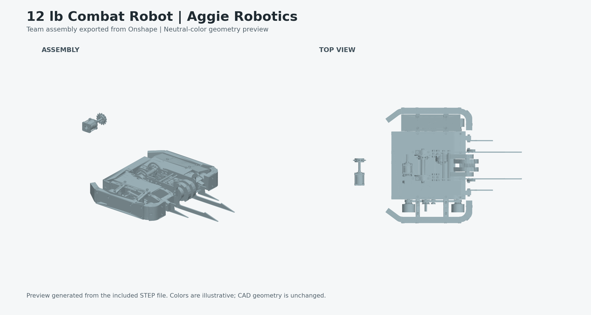

# William Gipson | Engineering Portfolio

**Mechanical Engineering & Physics | Texas A&M University | Expected May 2029**

I work across mechanical design, electronics testing, and scientific software. My experience includes robot chassis design, circuit troubleshooting and repair, and an interactive detector visualization interface for CMS alignment work.

[Email](mailto:william.clay.gipson@gmail.com) | [LinkedIn](https://www.linkedin.com/in/william-clay-gipson/)

## Live Interactive CMS Muon Viewer

**[OPEN THE INTERACTIVE 3D MUON VIEWER](https://wgipson.web.cern.ch/muon.html)**

Explore the detector model and select chambers to see their associated alignment plots. The link opens my separately hosted CERN website; this GitHub repository is the portfolio.

[Read about my contribution and how the viewer works](projects/cms-muon-viewer.md)

## Featured Project: 12 lb Combat Robot



**My work:** chassis and motor-mount design, clearance checks, improved motor replacement access, and weight-reduction revisions using Onshape. Assembled weight was reduced from **13.1 to 11.8 lb**, with mounting alignment and fastener retention checked during three drive-test sessions.

[Project details](projects/combat-robot.md) | [Download STEP assembly](https://github.com/Wunwill/engineering-portfolio/raw/refs/heads/main/assets/cad/12lb-combat-robot-assembly.step) | [CAD export details and team credit](assets/cad/EXPORT.md)

The CAD is an actual team assembly export, shared with permission. It includes work by other team members and components I did not design. The preview uses neutral display colors, not original material colors.

## More Engineering Work

| Project | My contribution | Relevant skills |
| --- | --- | --- |
| [Electronics Testing and Repair](projects/electronics-testing.md) | Diagnosed and repaired **12 shorted circuits**; verified repairs; reprogrammed **30 power modules** for KRIA compatibility | Thermal imaging, microscope inspection, resistance/continuity and voltage measurements, test records |
| [CMS Muon Detector Viewer](projects/cms-muon-viewer.md) - [Open interactive viewer](https://wgipson.web.cern.ch/muon.html) | Built an interactive 3D interface connecting detector selections to alignment residual plots | JavaScript, Three.js, JSROOT, HTML/CSS, Python, ROOT, Linux, Git/GitLab |

## Code Sample

[Chamber plot index](examples/chamber_plot_index.py) demonstrates a small part of the detector-to-plot lookup concept: parsing identifiers, validating selections, and retrieving matching files. It uses synthetic paths and needs only Python 3.10 or newer. The repository has 13 automated tests covering the code sample, CAD integrity, preview format, and local documentation links.

```bash
python examples/chamber_plot_index.py examples/synthetic_plot_paths.json --wheel -2 --station 1 --sector 5
python -m unittest discover -s tests -v
```

[View automated test results](https://github.com/Wunwill/engineering-portfolio/actions/workflows/tests.yml)

This sample was prepared for the portfolio with AI assistance. It is not the original CERN importer or a physics-analysis program. The original viewer's architecture and my contribution are described on its project page.

## Teamwork and Technical Communication

- **TAMU BUILD, student supervisor:** lead groups of 6-8 volunteers on shipping-container medical-clinic construction, translate site instructions into installation tasks, and check panel fit before fastening.
- **Engineering Mechanics teaching assistant:** guide 25 students through free-body diagrams, equilibrium, and support reactions in weekly help sessions.
- **STEM tutor:** break mathematics and science problems into manageable steps with an emphasis on conceptual understanding.

## Skills

**Mechanical:** Onshape, SolidWorks, parametric modeling, assemblies, dimensioned drawings, fit and clearance checks.

**Electronics:** bench testing, thermal inspection, resistance and voltage measurements, troubleshooting, repair verification.

**Programming and analysis:** Python, JavaScript, ROOT, Linux, Git/GitLab; Three.js and JSROOT for browser visualization.

This is a personal portfolio, not an official CERN, CMS, or Aggie Robotics publication. Research data, credentials, private test records, and CERN source code are not redistributed here.
